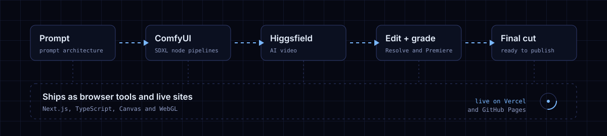
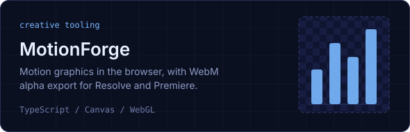
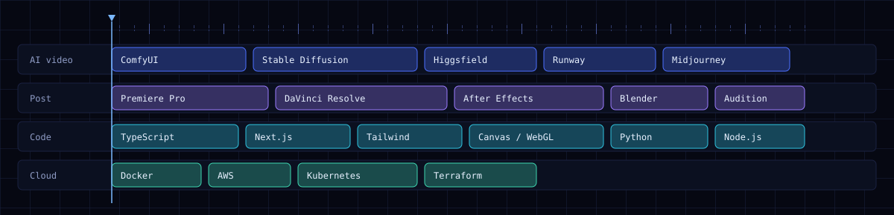
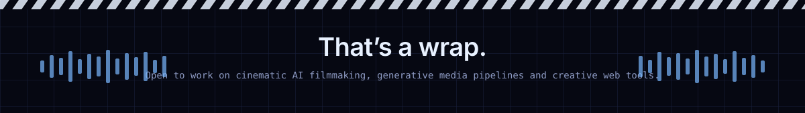

  

 

<table>
<tr>
<td width="38%" valign="top">
  
</td>
<td valign="top">
  
I lead creative and technical work at ZAI Labs. I build generative AI video pipelines, tools for video editors, and the sites that show them off.

  
<!-- LATEST:START -->

Open: <a href="https://github.com/saikrishna-bethamcharla/Epic-Hertz-Studio">Epic-Hertz-Studio</a> | <a href="https://github.com/saikrishna-bethamcharla/vasudhapharma-green">vasudhapharma-green</a> | <a href="https://github.com/saikrishna-bethamcharla/portfolio">portfolio</a> | <a href="https://github.com/saikrishna-bethamcharla/Portfolio-netflix-style">Portfolio-netflix-style</a> | <a href="https://github.com/saikrishna-bethamcharla/MotionForge">MotionForge</a>

<!-- LATEST:END -->
</td>
</tr>
</table>

## How it fits together

## Featured

  
  
  
  

Epic Hertz Studio runs live at [epic-hertz-studio.vercel.app](https://epic-hertz-studio.vercel.app/). There is also a [3D VHS-shelf portfolio](https://github.com/saikrishna-bethamcharla/portfolio), and more in [all repositories](https://github.com/saikrishna-bethamcharla/?tab=repositories).

## Toolbox

 

  <a href="https://saikrishna-bethamcharla.github.io/Portfolio/">Portfolio</a> |
  <a href="https://epic-hertz-studio.vercel.app/">Epic Hertz Studio</a>

