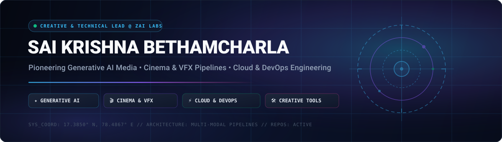

<div align="center">

<!-- Hero Banner -->


<!-- Dynamic Typing SVG Headline -->
<a href="https://github.com/saikrishna-bethamcharla">
  
</a>

<p align="center">
  <b>Creative & Technical Lead @ ZAI Labs Private Limited</b><br>
  <i>Pioneering the intersection of <b>Generative AI Media</b>, <b>Creative Tooling</b>, and <b>Cloud Engineering</b></i>
</p>

<!-- Badges Row -->
<p align="center">
  <a href="https://epic-hertz-studio.vercel.app/" target="_blank">
    
  </a>
  <a href="https://github.com/saikrishna-bethamcharla?tab=repositories">
    
  </a>
  <a href="https://www.instagram.com/saikrishna_bethamcharla?igsi=MWU3a2RtdGVwOGhveA%3D%3D&utm_source=qr" target="_blank">
    
  </a>
  
</p>

</div>

---

### ⚡ System Telemetry & Identity

```yaml
identity:
  name: Sai Krishna Bethamcharla
  title: Creative & Technical Lead
  organization: ZAI Labs Private Limited
  core_mission: "Automating visual imagination through generative intelligence and resilient cloud architectures"

domains:
  - Generative AI & Autonomous Video Pipelines (ComfyUI, Stable Diffusion, Higgsfield)
  - Next-Gen Video Production & Finishing (Premiere Pro, DaVinci Resolve, After Effects)
  - Creative Developer Tooling (MotionForge, Kinetic Captions, WebM Alpha Engines)
  - Cloud Infrastructure & SRE (Kubernetes Auto-Healing, AWS ECS, Terraform, CI/CD)

status:
  status_code: 200_ONLINE
  current_focus: "Scaling AI Video synthesis pipelines and real-time kinetic motion engines"
```

---

### 🚀 Flagship Engineered Projects

<table>
  <tr>
    <td width="50%" valign="top">
      <div align="center">
        <a href="https://github.com/saikrishna-bethamcharla/Epic-Hertz-Studio">
          
        </a>
      </div>
      <br>
      <b>🎬 AI Auto-Captioning & Kinetic Subtitle Engine</b>
      <p>High-performance kinetic subtitle generator designed for Reels, Shorts, and TikTok with an immersive 3D scroll-craft landing interface.</p>
      <ul>
        <li>⚡ <b>Live Application:</b> <a href="https://epic-hertz-studio.vercel.app/">epic-hertz-studio.vercel.app</a></li>
        <li>🛠️ <b>Tech Stack:</b> Next.js, TypeScript, Tailwind CSS, Web Audio, Framer Motion</li>
      </ul>
      <p align="center">
        <a href="https://github.com/saikrishna-bethamcharla/Epic-Hertz-Studio"><b>Explore Codebase →</b></a>
      </p>
    </td>
    <td width="50%" valign="top">
      <div align="center">
        <a href="https://github.com/saikrishna-bethamcharla/MotionForge">
          
        </a>
      </div>
      <br>
      <b>✨ Client-Side Motion Graphics & Alpha Video Studio</b>
      <p>Browser-based animation studio for editors: generate 3D charts, counters, lower-thirds with native WebM Alpha Transparency & Green Screen.</p>
      <ul>
        <li>⚡ <b>Workflow:</b> Direct drag-and-drop into DaVinci Resolve & Premiere Pro</li>
        <li>🛠️ <b>Tech Stack:</b> TypeScript, HTML5 Canvas, WebGL, Video Overlay Engine</li>
      </ul>
      <p align="center">
        <a href="https://github.com/saikrishna-bethamcharla/MotionForge"><b>Explore Codebase →</b></a>
      </p>
    </td>
  </tr>
  <tr>
    <td width="50%" valign="top">
      <div align="center">
        <a href="https://github.com/saikrishna-bethamcharla/ai-autohealing-k8s">
          
        </a>
      </div>
      <br>
      <b>🛡️ AI-Powered Kubernetes Auto-Healing Agent</b>
      <p>Self-healing Kubernetes autonomous controller that inspects container health anomalies, analyzes root-causes, and automatically redeploys pods.</p>
      <ul>
        <li>⚡ <b>Highlight:</b> Proactive anomaly detection & zero-downtime recovery</li>
        <li>🛠️ <b>Tech Stack:</b> Python, Kubernetes API, Prometheus, Docker</li>
      </ul>
      <p align="center">
        <a href="https://github.com/saikrishna-bethamcharla/ai-autohealing-k8s"><b>Explore Codebase →</b></a>
      </p>
    </td>
    <td width="50%" valign="top">
      <div align="center">
        <a href="https://github.com/saikrishna-bethamcharla/cloud_cost_optimizer">
          
        </a>
      </div>
      <br>
      <b>💰 Multi-Cloud Cost Analysis & Optimization Engine</b>
      <p>Automated cloud audit utility identifying underutilized compute, orphaned storage volumes, and misconfigured tiering across AWS & GCP.</p>
      <ul>
        <li>⚡ <b>Highlight:</b> Automated cost-saving telemetry reports & recommendations</li>
        <li>🛠️ <b>Tech Stack:</b> Python, Boto3, CloudWatch API, GCP SDK</li>
      </ul>
      <p align="center">
        <a href="https://github.com/saikrishna-bethamcharla/cloud_cost_optimizer"><b>Explore Codebase →</b></a>
      </p>
    </td>
  </tr>
</table>

---

### 🛠️ Technical Stack & Creative Arsenal

<div align="center">
  
</div>

<br/>

<table>
  <tr>
    <th width="25%">🔮 Generative AI & Synthesis</th>
    <th width="25%">🎬 Cinema & Post-Production</th>
    <th width="25%">💻 Software & Frontend</th>
    <th width="25%">☁️ Cloud & DevOps</th>
  </tr>
  <tr>
    <td valign="top">
      • <b>ComfyUI</b> (Node Pipelines)<br>
      • <b>Stable Diffusion / SDXL</b><br>
      • <b>Higgsfield AI</b><br>
      • <b>Runway Gen-3</b><br>
      • <b>Midjourney</b><br>
      • <b>Prompt Architecture</b><br>
      • <b>Multi-scene Continuity</b>
    </td>
    <td valign="top">
      • <b>Adobe Premiere Pro</b><br>
      • <b>DaVinci Resolve</b> (Color Science)<br>
      • <b>Adobe After Effects</b> (VFX)<br>
      • <b>Adobe Photoshop</b><br>
      • <b>Adobe Illustrator</b><br>
      • <b>Blender 3D</b><br>
      • <b>Adobe Audition</b>
    </td>
    <td valign="top">
      • <b>Python 3.x</b> (FastAPI, Automation)<br>
      • <b>TypeScript / JavaScript</b><br>
      • <b>Next.js / React</b><br>
      • <b>HTML5 / Modern CSS3</b><br>
      • <b>Tailwind CSS / Canvas API</b><br>
      • <b>Node.js Runtime</b><br>
      • <b>RESTful APIs</b>
    </td>
    <td valign="top">
      • <b>Kubernetes (K8s)</b><br>
      • <b>Docker & Containers</b><br>
      • <b>Amazon Web Services (AWS)</b><br>
      • <b>Terraform (IaC)</b><br>
      • <b>CI/CD (Jenkins, Actions)</b><br>
      • <b>GitOps Architecture</b><br>
      • <b>Linux Administration</b>
    </td>
  </tr>
</table>

---

### 📊 GitHub Diagnostics & Activity

<div align="center">
  <table border="0">
    <tr>
      <td align="center" style="border: none;">
        
      </td>
      <td align="center" style="border: none;">
        
      </td>
    </tr>
  </table>

  <br/>

  <picture>
    <source media="(prefers-color-scheme: dark)" srcset="https://raw.githubusercontent.com/saikrishna-bethamcharla/saikrishna-bethamcharla/output/github-contribution-grid-snake-dark.svg">
    <source media="(prefers-color-scheme: light)" srcset="https://raw.githubusercontent.com/saikrishna-bethamcharla/saikrishna-bethamcharla/output/github-contribution-grid-snake.svg">
    
  </picture>
</div>

---

### 🌐 Connect & Initiate Transmission

<div align="center">

Ready to collaborate on cinematic AI filmmaking, generative media pipelines, or cloud engineering infrastructure?

<br/>

<a href="https://github.com/saikrishna-bethamcharla">
  
</a>
&nbsp;
<a href="https://epic-hertz-studio.vercel.app/">
  
</a>
&nbsp;
<a href="https://www.instagram.com/saikrishna_bethamcharla?igsi=MWU3a2RtdGVwOGhveA%3D%3D&utm_source=qr">
  
</a>

<br><br>

```text
+-----------------------------------------------------------------------+
|  "Build the technology. Orchestrate the vision. Command the future."  |
|               © Sai Krishna Bethamcharla • ZAI Labs                  |
+-----------------------------------------------------------------------+
```

</div>
